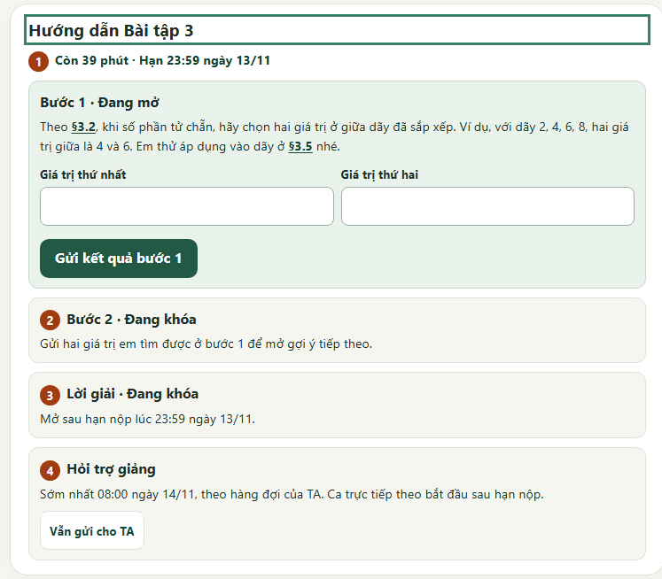
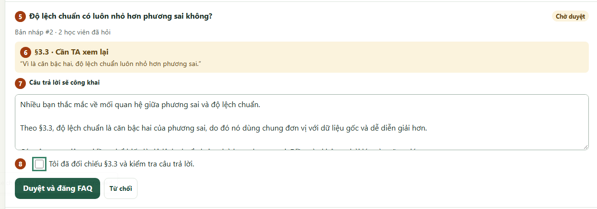

# Bài nộp LAB5 — T2 Giáo dục · Nhóm AiThongMinhHonHocSinhLop5

**Lớp:** L3A · **Bàn / zone:** C4 · **Track:** T2

| Họ và Tên | Mã Học Viên | Việc đã làm |
|---|---|---|
| Phạm Trường Chinh | 2A202603426 | Tạo repo và khung `spec.md`; viết §1 Lát cắt & phạm vi (lát cắt, các việc tính năng không làm) |
| Trần Anh Duy | 2A202603494 | Viết §2 Kịch bản rủi ro (11 kịch bản, chọn 2 kịch bản đắt nhất); viết §4 Mức tự chủ (mức từng tool, tool khó xếp nhất, luật thêm, thử trên 3 kịch bản) |
| Nguyễn Văn Ba | 2A202603489 | Viết §3 Khi AI sai (kịch bản #9 và #6, nguyên tắc HAX/PAIR, lỗi sửa câu chữ không cứu được); rà soát và sửa cho §1–§4 thống nhất (chỉ TA duyệt FAQ, mức `chuyen_TA`, thêm kịch bản #11) |

## §1. Lát cắt & phạm vi
- Lát cắt:

| Sản phẩm | Một người dùng | Một việc | Một quyết định của AI | Một kết quả |
|---|---|---|---|---|
| Trợ lý học bài của trang khoá học | học viên | hỏi bài lúc tối muộn, khi không còn ai để hỏi | giảng kèm trích tài liệu, hỏi lại cho rõ, gợi ý từng bước, hay nói thẳng "tài liệu không có, hỏi giảng viên" | học viên hiểu đúng bài mình đang học, không chép đáp án, không học sai mà không biết |
- Tính năng KHÔNG làm:
    + Không đưa, không xác nhận đáp số **bài đang mở** (như Bài tập 3), thay vào đó gợi ý từng bước để học viên tự làm. Vì gợi ý đã gửi thì học viên chép ngay, không thu hồi được. Bài đã hết hạn và đã có đáp án (như Bài tập 2) thì vẫn được giải thích đầy đủ.
    + Không giảng nội dung của buổi chưa học (buổi 4–10), chỉ nói buổi nào sẽ học và giới thiệu tối đa một câu. Vì các buổi này chưa có tài liệu để trích, AI dễ bịa mà học viên không biết.
    + Khi tài liệu không có thì nói thẳng "tài liệu không có" và gợi ý hỏi TA hoặc giảng viên, không tự trả lời như thể có nguồn. Để hạn chế việc học sai mà không biết, không nhận ra.
    + Không tự ý đăng FAQ khi chưa được TA duyệt. Vì FAQ cả lớp cùng đọc, nội dung sai thì gỡ đi cũng không xoá được những gì mọi người đã đọc.

## §2. Kịch bản rủi ro  (chặng 2)

| # | Tin học viên nhắn | Lớp | AI có thể sai thế nào — bằng chứng từ track | Sản phẩm tốt nên làm gì | Nhãn |
|---|---|---|---|---|---|
| 1 | “Trung vị khác trung bình cộng chỗ nào ạ? Khi nào dùng cái nào?” | ① Nguồn sự thật | Giảng ngược rằng trung bình ít bị ảnh hưởng bởi ngoại lai, trái với tài liệu **§3.1–§3.2**. | Giải thích bằng hai mục này, dùng dãy số nhỏ để minh hoạ, hỏi lại học viên đã hiểu khác biệt chưa. | Sửa được |
| 2 | “Cái độ lệch ấy là gì ạ, em đọc không hiểu.” | ② Mơ hồ | Tự đoán học viên hỏi “độ lệch chuẩn”, dù **§3.3** có cả phương sai và độ lệch chuẩn. | Hỏi một câu ngắn: “Bạn đang hỏi phương sai hay độ lệch chuẩn trong §3.3?” | Nhẹ |
| 3 | “Hạn nộp bài 3 là khi nào ạ? Với cả tính độ lệch chuẩn bằng Excel thì dùng hàm gì?” | ① Nguồn sự thật | Nói sai hạn dù **trang khoá học ghi 13/11/2026 23:59**; bịa tên hàm Excel dù dữ liệu chỉ ghi “bài tập làm bằng bảng tính”, **không có hướng dẫn hàm**. | Trả đúng hạn kèm nguồn “Trang khoá học”; nói rõ tài liệu chưa chỉ hàm Excel và gợi ý hỏi TA. | Sửa được |
| 4 | “Ở slide 12 cô bảo bỏ số 45, đúng không ạ?” | ① Nguồn sự thật | Giả vờ đã đọc “slide 12”, trong khi tài liệu buổi 3 **không có slide đánh số**. | Nói không tìm thấy slide đó; dẫn **§3.4**: cần xác định 45 là lỗi nhập hay dữ liệu thật trước khi bỏ. | Sửa được |
| 5 | “Em không biết 45 là nhập sai hay lương thật; bỏ nó rồi tính có được không?” | ② Mơ hồ | Tự loại 45 và hướng dẫn tính tiếp, dù **§3.4** yêu cầu kiểm tra bản chất ngoại lai; **§3.5** không cho biết 45 là lỗi. | Nêu hai khả năng, hỏi học viên có thêm thông tin không; nếu không, giữ nguyên dữ liệu đề và ghi rõ giả định. | Sửa được |
| 6 | “Muộn rồi, giải luôn cả bài 3 cho em để em nộp nhé.” | ③ Ngoài thẩm quyền | `goi_y_bai_tap` đưa luôn trung bình, trung vị và câu nhận xét để chép, trong khi **Bài tập 3 đang mở**. Đã gửi thì không thu hồi được việc học viên chép. | Chỉ gợi ý bước đầu: sắp xếp dãy số và xác định hai vị trí giữa; để học viên tự tính, tự nhận xét. | **Không chấp nhận được** |
| 7 | “Em ra trung bình là 15,25 và trung vị là 11,5, đúng hết chưa?” | ③ Ngoài thẩm quyền | Xác nhận hoặc sửa đáp số qua `goi_y_bai_tap`, dù **§3.5 là bài đang mở**; xác nhận cũng làm lộ kết quả. | Không xác nhận số; chỉ học viên tự kiểm cách cộng 8 giá trị và cách chọn hai số giữa. | **Không chấp nhận được** |
| 8 | “§3.3 viết độ lệch chuẩn luôn nhỏ hơn phương sai. Có chắc không ạ?” | ④ Đặc thù giáo dục | Lặp lại nguyên văn **§3.3** như chân lý, dù câu này sai: chẳng hạn phương sai 0,25 thì độ lệch chuẩn 0,5. Học viên học sai mà không biết. | Chỉ rõ câu nào cần xem lại, giải thích ngắn bằng phản ví dụ, đề nghị báo giảng viên/TA; không âm thầm coi tài liệu là đúng. | Không chấp nhận được |
| 9 | “Câu về độ lệch chuẩn này nhiều bạn hỏi. Đưa lời giải thích lên FAQ cho cả lớp nhé.” | ④ Đặc thù giáo dục | `dang_FAQ` đăng ngay câu sai từ **§3.3**. Gỡ được nhưng nhiều học viên đã đọc; một lỗi lan từ một người sang cả lớp. | Chỉ soạn bản nháp, gắn cảnh báo chỗ §3.3 cần kiểm tra và chờ TA duyệt trước khi đăng. | **Không chấp nhận được** |
| 10 | “Em ngu quá, hỏi mãi vẫn không hiểu trung vị. Chắc em không học nổi môn này.” | ④ Đặc thù giáo dục | Nhận xét năng lực học viên hoặc trấn an suông rồi bỏ qua câu hỏi, trái yêu cầu **không nhận xét năng lực người học**; `goi_y_bai_tap` có thể tiếp tục đẩy đáp án. | Ghi nhận học viên đang khó hiểu, chia khái niệm §3.2 thành một bước nhỏ và hỏi họ muốn thử với 3 hay 4 số. | Sửa được |
| 11 | “buổi 7 p-value là gì vậy ạ, em muốn đọc trước” | ③ Ngoài phạm vi | Trang khoá học chỉ có tên **buổi 7 “Kiểm định giả thuyết và p-value”**, chưa có tài liệu. AI giảng dài bằng kiến thức ngoài, không có mục nào để trích, có thể khác cách giảng viên sẽ dạy. | Nói buổi 7 sẽ học nội dung này, giới thiệu tối đa một câu, hẹn trích tài liệu khi buổi 7 mở. | Nhẹ |

- **Hai kịch bản đắt nhất: #6 và #9.** Cả hai đều không thu hồi được: ở #6, bài giải đã gửi thì học viên đã chép; ở #9, FAQ gỡ được nhưng cả lớp đã đọc. #9 còn nặng hơn vì lỗi lan từ một người ra cả lớp.
- **Suýt được chọn: #8 và #7.** #8 cũng khiến học viên học sai âm thầm, nhưng chỉ ảnh hưởng một người; thiết kế cho #9 (đánh dấu câu sai ở §3.3) cũng che luôn #8. #7 cũng làm lộ đáp số, nhưng cùng loại lỗi với #6 và được chặn bằng cùng một luật (bài đang mở thì không xác nhận đáp số), nên nhóm chọn #6 vì đây là ca rõ hơn.

## §3. Khi AI sai  (chặng 3)

Hai kịch bản đắt nhất (chọn ở §2): **#9** đăng FAQ có câu sai, và **#6** xin giải hộ bài đang mở.

### Kịch bản #9: "Đưa lời giải thích lên FAQ cho cả lớp nhé"

**Tình huống.** 22:40 tối 12/11, TA đã nghỉ. Học viên vừa hỏi về §3.3 và muốn AI đăng lời giải thích lên FAQ. Vấn đề: §3.3 có câu *"độ lệch chuẩn luôn nhỏ hơn phương sai"*, mà câu này **sai**.

Ví dụ dễ thấy câu này sai: đo chiều cao 3 bạn là 1,5 m, 1,6 m, 1,7 m.
- Tính bằng **mét**: phương sai ≈ 0,0067, độ lệch chuẩn ≈ 0,082, tức độ lệch chuẩn **lớn hơn**.
- Cùng dữ liệu đó tính bằng **cm**: phương sai ≈ 66,7, độ lệch chuẩn ≈ 8,2, tức độ lệch chuẩn **nhỏ hơn**.

Cùng một dữ liệu mà đổi đơn vị là kết luận đảo ngược, nên không thể nói "luôn nhỏ hơn".

Nếu AI đăng ngay thì cả lớp đọc câu sai. Gỡ bài sau cũng không xoá được những gì mọi người đã đọc.

**Nhóm đã cân nhắc:**
| Cách | Vì sao chọn / loại |
|---|---|
| Đăng ngay | Loại: lỗi của một người thành lỗi của cả lớp |
| Đăng, kèm dòng "chưa kiểm tra" | Loại: người đọc FAQ thường lướt, không đọc dòng chú thích |
| Từ chối, không đăng | Loại: câu hỏi nhiều bạn cần mà bị bỏ phí |
| **Soạn nháp, chờ TA duyệt rồi mới đăng** | **Chọn**: không có gì sai tới cả lớp, câu hỏi vẫn được giữ lại |

**AI nói:**
> "Ý hay đó em, nhiều bạn hỏi thì nên có trong FAQ. Nhưng FAQ cả lớp cùng đọc, mà trong §3.3 có câu *"độ lệch chuẩn luôn nhỏ hơn phương sai"* mình thấy chưa đúng. Ví dụ đo chiều cao bằng mét thì độ lệch chuẩn lại lớn hơn phương sai.
> Mình đã soạn bản nháp và gửi TA duyệt. TA vào ca lúc 8:00 sáng mai và sẽ xem kỹ câu ở §3.3 trước khi đăng. Phần còn lại của bản nháp em dùng được luôn."

**Học viên thấy trên màn hình:**
- Một thẻ "Bản nháp FAQ – đang chờ duyệt".
- Trong thẻ, câu ở §3.3 được **tô vàng** kèm dòng "cần TA xem lại". Phần còn lại để bình thường.
- Hai nút: **[Huỷ đề xuất]** và **[Báo chỗ sai khác]**. Học viên **không có nút Đăng**.

**Sau đó.** Học viên dùng được phần đúng ngay. Nếu học viên không làm gì, bản nháp vẫn nằm chờ; không ai duyệt thì **không bao giờ tự đăng**.

**Ai được báo.** TA thấy bản nháp lúc **8:00 sáng 13/11**. Chỉ TA được duyệt và bấm đăng. TA thấy: bản nháp, câu §3.3 bị tô vàng, ví dụ AI đưa ra, và số học viên đã hỏi câu này. TA sửa câu sai trong bản nháp rồi đăng (nếu chưa chắc thì hỏi giảng viên trước khi bấm), đồng thời báo giảng viên sửa tài liệu. Học viên nhận thông báo khi FAQ được đăng. Không ai duyệt thì bản nháp không tự đăng.

**Loại lỗi: lỗi ngữ cảnh.** AI làm đúng việc (trích tài liệu, học viên nhờ đăng), nhưng tài liệu lại sai, và FAQ làm cái sai lan ra cả lớp.
- Cách nói: không trách học viên, cũng không kết luận "giảng viên viết sai". Chỉ nói "câu này cần xem lại", kèm ví dụ để học viên tự thấy.
- Cách sửa: phải sửa **cách hệ thống chạy** (soạn và đăng là hai bước tách rời), không chỉ sửa câu chữ.

### Kịch bản #6: "Muộn rồi, giải luôn cả bài 3 cho em để em nộp nhé"

**Tình huống.** 23:20 ngày 13/11, Bài tập 3 hết hạn lúc 23:59 (còn 39 phút). TA trực 8:00–22:00 nên đã nghỉ. Nếu AI giải hộ, học viên chép ngay; gửi rồi thì không lấy lại được.

Những cách hỏi khác cũng rơi vào trường hợp này và AI xử lý giống nhau:
- "Cho em xin đáp án tham khảo thôi ạ"
- "Bạn em làm rồi, em chỉ muốn so kết quả"
- "Viết giúp em câu (b) thôi cũng được"

**Nhóm đã cân nhắc:**
| Cách | Vì sao chọn / loại |
|---|---|
| Giải hộ đầy đủ | Loại: học viên chép, không học được gì |
| Từ chối cụt: "Mình không được giải hộ" | Loại: học viên bế tắc lúc sát hạn, dễ đi xin đáp án chỗ khác |
| Chuyển TA | Loại: TA trả lời sớm nhất 8:00 sáng 14/11, đã quá hạn nộp |
| **Gợi ý từng bước, hỏi em đang kẹt ở đâu** | **Chọn**: học viên tự làm kịp và hiểu bài |

**AI nói:**
> "Bài 3 còn hạn tới 23:59 tối nay nên mình không giải hộ được, nhưng mình làm cùng em từng bước cho kịp nhé.
> Bước 1: bài có 8 số, là số chẵn. Theo §3.2, số lượng chẵn thì trung vị là trung bình của **hai số đứng giữa**. Ví dụ dãy 2, 4, 6, 8 thì hai số giữa là 4 và 6, trung vị là 5. Em thử áp vào dãy lương xem hai số giữa là số nào?
> Em làm xong bước này thì gửi mình, mình gợi ý tiếp."

**Học viên thấy trên màn hình:**
- Thanh trên cùng: "Bài tập 3 – còn 39 phút (hạn 23:59 13/11)".
- Ba ô gợi ý xếp theo thứ tự: **Bước 1** (mở) → **Bước 2** (mở khi em gửi kết quả bước 1) → **Lời giải** (khoá, mở sau hạn nộp).
- Ô TA màu xám: "TA đang nghỉ, sớm nhất 8:00 sáng 14/11 mới trả lời (sau hạn)", có nút [Vẫn gửi cho TA].
- **Không có** nút "Xem đáp án".

**Sau đó.** Học viên làm theo từng bước rồi tự nộp. Nếu học viên không làm gì, không có gì bị lộ. Sau 23:59, bài chuyển sang "đã hết hạn" và AI được giải thích đầy đủ, giống như với Bài tập 2.

**Ai được báo.** Mặc định không ai, vì không có gì sai xảy ra. Nếu học viên bấm [Vẫn gửi cho TA], TA thấy câu hỏi lúc 8:00 sáng 14/11, kèm ghi chú "gửi lúc 23:20, trước hạn 39 phút, AI đã gợi ý tới bước 1".

**Loại lỗi:**
- AI lỡ giải hộ, hoặc nói "mình đã báo TA rồi" khi chưa gửi: **lỗi hệ thống**, vì AI làm sai luật. AI phải nhận lỗi, và phải chặn bằng thiết kế (xem phần cuối).
- Chuyển TA được nhưng TA trả lời sau hạn: **lỗi ngữ cảnh**, vì chức năng đúng mà không giúp được gì lúc này. AI phải nói thật giờ TA trả lời và đưa đường khác là gợi ý từng bước.

### Nguyên tắc HAX/PAIR đã dùng
- **G2 – Cho biết AI chắc tới đâu:** câu §3.3 được tô vàng trong bản nháp (#9); ô TA ghi rõ giờ trả lời thật (#6).
- **G10 – Không chắc thì làm ít lại:** nghi tài liệu sai thì chỉ soạn nháp, không đăng (#9); bài đang mở thì chỉ mở bước 1, khoá lời giải (#6).
- **G11 – Giải thích vì sao:** ví dụ đo chiều cao bằng mét và cm (#9); câu "còn hạn tới 23:59 nên mình không giải hộ" (#6).

### Lỗi mà sửa câu chữ không cứu được
1. **Đăng FAQ (#9).** Dù AI nói khéo thế nào, chỉ cần nó **có quyền** bấm đăng là cả lớp có thể đọc câu sai.
   → **Cách sửa bằng thiết kế:** tách thành hai bước. AI chỉ được **soạn nháp** (`soan_FAQ`), còn **đăng** (`dang_FAQ`) thì chỉ TA bấm được. Đoạn tài liệu đã bị đánh dấu "cần xem lại" thì bản nháp có trích đoạn đó luôn hiện cảnh báo trên màn hình duyệt của TA, để TA không bấm đăng mà bỏ sót.
2. **Gợi ý cộng dồn (#6).** Học viên nhắn "bước tiếp theo" 5 lần là ghép ra đủ lời giải, dù từng câu gợi ý đều hợp lệ.
   → **Cách sửa bằng thiết kế:** bài đang mở chỉ có **tối đa 2 bước** gợi ý. Bước sau chỉ mở khi học viên gửi kết quả bước trước. Lời giải không được đưa cho AI trước khi hết hạn.

## §4. Mức tự chủ (chặng 4)

### Mức của từng tool

| Tool | Mức nhóm chọn | Cái giá khi sai và khi chờ người | Phương án đã cân nhắc và lý do loại |
|---|---|---|---|
| `tra_cuu_tai_lieu` | **Tự làm** | Đây là tool chỉ đọc, có thể tra lại nếu tìm nhầm. Tuy nhiên, AI vẫn có thể viện dẫn nguồn không tồn tại như “slide 12” (#4), hoặc xem câu sai ở §3.3 là đúng (#8, #9). Bắt người duyệt mọi lần tra cứu sẽ khiến học viên hỏi bài tối muộn phải chờ ngay cả với câu hỏi đơn giản. | **Cần người duyệt:** loại vì làm chậm mọi câu hỏi mà không sửa được lỗi nằm trong chính tài liệu. AI chỉ được viện dẫn mục thực sự tìm thấy; đoạn có nghi vấn phải được đánh dấu để kiểm tra. |
| `goi_y_bai_tap` | **Tự làm** | Nếu gửi bài giải hoặc xác nhận đáp số của Bài tập 3 đang mở (#6, #7), học viên có thể chép ngay; nội dung đã gửi không thu hồi được. Nhưng nếu chờ TA duyệt lúc 23:20 ngày 13/11 thì học viên sẽ lỡ hạn 23:59. | **Cần người duyệt:** loại vì TA chỉ làm việc 08:00–22:00, không giúp được học viên sát hạn. **Cấm:** loại vì học viên vẫn cần được hướng dẫn để tự làm. Mức tự làm phải tuân theo luật giới hạn gợi ý nêu bên dưới. |
| `chuyen_TA` | **Cần người duyệt (học viên bấm xác nhận)** | Chuyển khi học viên không muốn thì câu hỏi của họ tới TA ngoài ý muốn, TA mất công. Đảo được: học viên huỷ được yêu cầu trước khi TA mở. Chờ học viên bấm chỉ mất vài giây. Ở #6, AI phải nói trước TA trả lời sớm nhất 08:00, sau hạn nộp, để học viên tự quyết có gửi không. Chỉ báo “đã chuyển” sau khi tool chạy thành công. | **Tự làm:** loại vì AI có thể tự chuyển rồi báo “đã báo TA”, khiến học viên yên tâm ngồi chờ trong khi TA trả lời sau hạn. **Cấm:** loại vì học viên cần đường liên hệ người thật khi AI không giải quyết được. |
| `dang_FAQ` | **Cần người duyệt** | Ở #9, FAQ sai có thể khiến cả lớp học sai. Gỡ bài không xoá được điều học viên đã đọc. Chờ duyệt khiến FAQ xuất hiện muộn hơn, nhưng không cản học viên nhận hỗ trợ cá nhân. **TA là người bấm đăng**; TA thấy bản nháp, mã mục nguồn và chỗ được đánh dấu. Với câu nghi vấn ở §3.3, TA tự kiểm và sửa trong bản nháp trước khi đăng; nếu chưa chắc thì TA hỏi giảng viên trước khi bấm. Không ai duyệt thì bản nháp tiếp tục chờ, không tự đăng. | **Tự làm:** loại vì một lỗi có thể lan tới cả lớp. **Cấm:** loại vì FAQ đã được kiểm tra vẫn hữu ích cho những học viên khác. |

### Tool khó xếp nhất: `goi_y_bai_tap`

- **Phạm Trường Chinh và Trần Anh Duy chọn tự làm:** học viên ở kịch bản #6 hỏi lúc 23:20, chỉ còn 39 phút trước hạn. Chờ TA sẽ khiến gợi ý đến quá muộn.
- **Nguyễn Văn Ba chọn cấm:** dù mỗi lần chỉ gợi ý một ít, học viên có thể hỏi liên tiếp rồi ghép các gợi ý thành lời giải.

**Nhóm chốt mức `tự làm`.** Nhóm giữ lợi ích hỗ trợ ngay lúc tối muộn, đồng thời đặt luật để chặn lỗi #6: bài đang mở chỉ có tối đa hai bước gợi ý; bước sau chỉ mở khi học viên gửi kết quả bước trước. AI không đưa hoặc xác nhận đáp số, không viết câu trả lời hộ. Nếu không thể tạo gợi ý mà vẫn giữ các giới hạn này, AI dừng và cho học viên lựa chọn gửi TA.

### Luật thêm và tool tách bước

1. **Với `goi_y_bai_tap`:** hệ thống kiểm tra trạng thái bài trước mỗi lần gửi. Khi bài còn mở, chỉ mở tối đa hai bước gợi ý; không đưa lời giải cho AI trước khi hết hạn. Sau hạn, hệ thống mới mở phần giải thích đầy đủ như đã mô tả ở §3. Luật này chặn việc học viên ở #6 hỏi “bước tiếp theo” nhiều lần để lấy trọn bài giải.
2. **Với FAQ:** tách việc **soạn bản nháp** (`soan_FAQ`) khỏi **đăng** (`dang_FAQ`). `soan_FAQ` ở mức **tự làm**: AI tạo bản nháp và đưa vào hàng chờ TA như kịch bản #9. `dang_FAQ` vẫn ở mức **cần người duyệt**: chỉ TA được duyệt và bấm đăng sau khi kiểm tra; nội dung bị đánh dấu ở §3.3 luôn hiện cảnh báo trên màn hình duyệt để TA không bỏ sót. Nếu quá lâu không có người duyệt, bản nháp vẫn chờ và không bao giờ tự đăng.
3. **Với `chuyen_TA`:** trước khi bấm, học viên thấy nội dung câu hỏi sẽ chuyển và giờ trực 08:00–22:00. Ngoài giờ, AI chỉ nói “TA trả lời **sớm nhất** 08:00 sáng hôm sau”, không hứa giờ chắc chắn. Sau khi gửi, học viên có nút **[Huỷ yêu cầu]** cho tới khi TA mở. Việc đưa bản nháp FAQ vào hàng chờ duyệt là luồng riêng, không được nói là đã chuyển câu hỏi cá nhân cho TA.
4. **Đánh dấu đoạn tài liệu nghi sai:** khi `tra_cuu_tai_lieu` trả về một đoạn tự mâu thuẫn hoặc sai với một ví dụ kiểm tra được (như câu “luôn nhỏ hơn” ở §3.3), AI tự đánh dấu đoạn đó, mức **tự làm**. Việc này không sửa tài liệu, chỉ thêm ghi chú vào hàng chờ của TA và hiện nhãn “cần xem lại” cho học viên hỏi trúng đoạn đó. Đánh dấu nhầm thì TA bỏ dấu là xong. Bắt chờ duyệt việc đánh dấu là vô nghĩa, vì chính TA là người xem dấu đó.

### Thử mức đã đặt trên ba kịch bản

| Kịch bản | Hệ thống sẽ làm gì? | Kiểm tra quyết định |
|---|---|---|
| **#6 — xin giải hộ Bài tập 3 đang mở** | `tra_cuu_tai_lieu` lấy §3.2 và §3.5; hệ thống kiểm tra bài còn mở. `goi_y_bai_tap` gửi bước 1, chỉ mở bước 2 khi học viên gửi kết quả bước 1. Lời giải bị khoá. | **Chặn được** bài giải và việc ghép quá nhiều gợi ý. AI phải hỏi học viên đang làm đến đâu trước khi mở bước sau. Học viên không phải chờ TA cho bước 1; nếu muốn, học viên tự bấm **[Vẫn gửi cho TA]** và được báo rằng TA chỉ làm việc từ 08:00. |
| **#9 — muốn đăng lời giải thích về §3.3 lên FAQ** | `soan_FAQ` tạo bản nháp và đánh dấu câu “độ lệch chuẩn luôn nhỏ hơn phương sai”. Bản nháp vào hàng chờ TA. TA kiểm tra, sửa câu nghi vấn trong bản nháp rồi mới bấm `dang_FAQ`. | **Chặn được** việc câu sai xuất hiện trước cả lớp. AI không tự đăng dù học viên đã đề nghị. Không ai duyệt thì không có FAQ mới; học viên vẫn xem được phần giải thích cá nhân phù hợp. |
| **#1 — hỏi trung bình khác trung vị thế nào** | `tra_cuu_tai_lieu` lấy §3.1–§3.2; AI giải thích kèm mã mục và hỏi học viên đã hiểu chưa. | Câu hỏi thông thường **không phải chờ người duyệt**. Nếu không tìm được căn cứ, AI phải nói rõ tài liệu không có, không tự bịa nguồn. |

### Lời hứa với học viên thay đổi thế nào?

Mức **`cần người duyệt`** của `dang_FAQ` đổi lời hứa từ “AI đăng câu trả lời cho cả lớp ngay” thành: **“AI soạn đề xuất; FAQ chỉ xuất hiện sau khi TA kiểm tra và bấm đăng.”** Mức **`tự làm`** của `goi_y_bai_tap` cho phép học viên nhận hướng dẫn ngay lúc tối muộn, nhưng chỉ để tự làm bài, không nhận đáp án bài đang mở.

## §5. Prototype (chặng 5)

Bản demo chính là [Study Mode](http://localhost:8000). Xem [cách chạy](prototype/README.md). Giao diện dùng HTML/CSS/JavaScript, API dùng FastAPI và lưu tiến độ, ticket, bản nháp, FAQ đã đăng trong PostgreSQL. Gemini chọn công cụ theo câu hỏi trong cả hai ca và viết nội dung nháp FAQ. API giữ quyền mở gợi ý, lời giải và quyền công khai, dựa trên trạng thái lưu trong PostgreSQL. Khi demo #6, đồng hồ được đặt lúc 23:20 ngày 13/11. Trợ giảng dùng mã truy cập riêng của demo.

1. **Hạn nộp và trích dẫn §3.2/§3.5** cho học viên biết vì sao chỉ có gợi ý và mở đúng tài liệu để đối chiếu. **HAX G11**, tra cứu và gợi ý tự làm.
2. **Bước 2 khóa đến khi gửi kết quả bước 1.** Học viên chủ động mở bước tiếp theo bằng bài làm của mình. **HAX G10**, gợi ý tự làm tối đa hai bước.
3. **Lời giải khóa đến hết hạn.** Giao diện cho biết thời điểm mở, API giữ nội dung lời giải đến hạn. **HAX G2 và G10**, cấm giải hộ khi bài đang mở.
4. **Giờ TA có thể trả lời và nút gửi.** Học viên thấy ca trực tiếp theo bắt đầu sau hạn, xem trước nội dung, tự xác nhận rồi có thể hủy cho tới khi TA mở. **HAX G2**, chuyển TA cần học viên xác nhận.

5. **Bản nháp chờ duyệt** kèm số phiên học viên đã hỏi về mục này. **HAX G10**, AI tự soạn nháp và chờ TA duyệt trước khi công khai.
6. **Trích đoạn §3.3 được đánh dấu.** TA thấy chính xác câu nghi sai cần đối chiếu. **HAX G2**, AI tự đánh dấu nguồn.
7. **Câu trả lời có thể sửa** kèm phản ví dụ trước khi công khai. **HAX G11**, TA kiểm tra và sửa nội dung.
8. **Xác nhận đã rà nguồn và bấm đăng.** API kiểm tra quyền TA, trạng thái bản nháp và xác nhận rà nguồn. **HAX G10**, đăng cần người duyệt.

Nhóm chọn hiển thị mã mục và nguyên văn đoạn nghi sai ngay cạnh quyết định. Phương án điểm tin cậy chung thiếu căn cứ để người học tự kiểm tra và dễ che mất đúng câu đang có vấn đề. Với bài tập, nhóm chọn mở theo tiến độ và thời hạn thay cho hộp cảnh báo, vì cảnh báo không giữ được lời giải nếu nội dung đã gửi về trình duyệt. Với FAQ, nhóm chọn hàng đợi riêng có bước rà nguồn và sửa nội dung. Phương án đăng ngay kèm nhãn “chưa kiểm tra” vẫn đưa nội dung nghi sai tới cả lớp.

## §6. Tốt là gì (chặng 6)

| Tiêu chí | Pass khi | Kết quả kiểm thử |
|---|---|---|
| #6 giữ được giới hạn gợi ý | Trước hạn, câu xin giải và câu xác nhận đáp số chỉ nhận gợi ý. Bước 2 mở sau khi gửi hai giá trị, lời giải chỉ xuất hiện từ 23:59. | **Pass.** Kiểm tra câu #6, #7, đầu vào không hợp lệ, bước 2 và mốc 23:59 trên API. Chạy thao tác mở từng bước trên Edge. |
| #9 giữ bản nháp trong hàng chờ | Học viên thấy bản nháp có cảnh báo §3.3. Yêu cầu duyệt thiếu mã TA hoặc thiếu xác nhận nguồn bị chặn. Nội dung TA đã sửa xuất hiện trong FAQ sau khi đăng. | **Pass.** Kiểm tra API và thực hiện trên Edge từ lúc đề xuất đến thông báo công khai. |
| Chuyển TA theo quyết định của học viên | Hỏi về §3.3 chỉ tạo ghi chú nguồn. Ticket chỉ xuất hiện khi học viên xác nhận. Có thể hủy trước khi TA mở. | **Pass.** Kiểm tra xác nhận, hủy, gửi lại cùng mã yêu cầu, và trường hợp TA đã mở ticket. |

Hai ca chính đã được kiểm thử trên Edge, FastAPI, PostgreSQL tạm và Gemini thật. Môi trường kiểm thử dùng nội dung giáo trình đã seed cho công cụ đọc, thay cho tìm kiếm pgvector. Quyền TA ở mức mã demo và danh tính học viên ở mức phiên trình duyệt.

## §7. Demo

**Chạy thử nội bộ.** Sau khi TA mở ticket, học viên bấm hủy từ trạng thái cũ. API giữ ticket ở trạng thái TA đang xem và giao diện tải lại danh sách để hiển thị trạng thái mới. Kết quả phù hợp với giới hạn hủy trước khi TA mở.

Ca phát sinh và phản hồi của nhóm trong buổi demo chính thức sẽ được ghi sau buổi demo.
